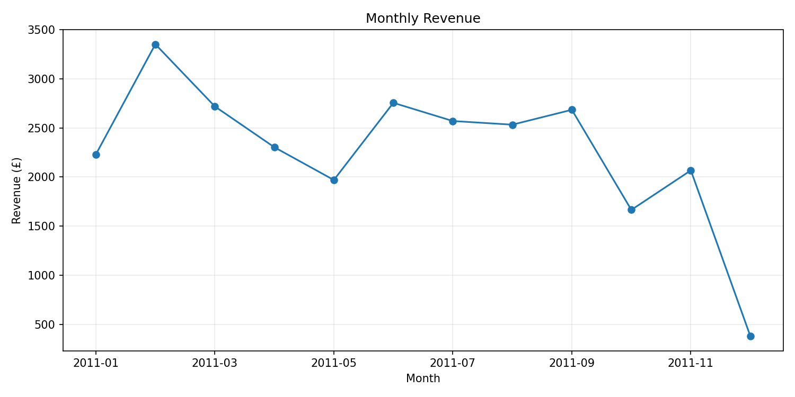
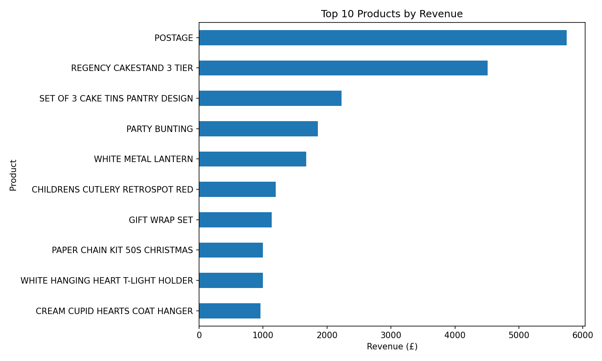
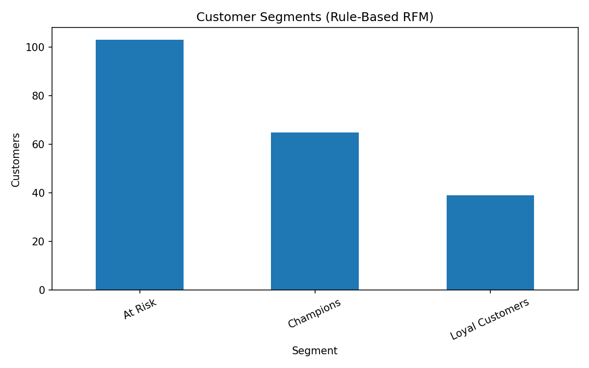

# SalesLens — Retail Sales & Business Insights

A beginner-friendly data analytics portfolio project using **Python, SQL, Pandas and Matplotlib** to explore historical online retail transactions. It includes a small Streamlit dashboard, SQL practice queries, customer RFM features, tests and reproducible charts.

> **Important data note:** The included sample is synthetic and is only for demonstrating that the code runs. For genuine findings, download the official UCI Online Retail dataset and rerun the pipeline. Do not describe synthetic demo results as real customer or company findings.

## What this project answers

- What is the total revenue and average order value?
- How does revenue change month by month?
- Which products generate the highest revenue?
- Which countries contribute the most revenue?
- At what hours are the most invoices recorded?
- What simple RFM groups can be described for customers with an ID?
- How much source data is removed or excluded during cleaning?

## Technology

Python 3.10+, Pandas, SQLite, SQL, Matplotlib, Streamlit, pytest.

## Quick start (Windows)

```powershell
py -m venv .venv
.venv\Scripts\activate
python -m pip install -r requirements.txt
python run_analysis.py
```

## Quick start (macOS/Linux)

```bash
python3 -m venv .venv
source .venv/bin/activate
python -m pip install -r requirements.txt
python run_analysis.py
```

The first run uses `data/sample/online_retail_sample.csv`, which is synthetic. It creates:

- `data/processed/cleaned_sales.csv`
- `data/processed/customer_rfm.csv`
- `data/saleslens.sqlite`
- `outputs/summary.json`
- `outputs/charts/*.png`

## Use the full official dataset

1. Download **Online Retail.xlsx** from the [UCI Machine Learning Repository](https://archive.ics.uci.edu/dataset/352/online+retail).
2. Put it at `data/raw/Online Retail.xlsx`, or use `python download_dataset.py` after installing requirements.
3. Run `python run_analysis.py` again. The pipeline prioritises a raw full dataset over the synthetic sample.

UCI reports 541,909 instances for this dataset. Source: Chen, D. (2015). *Online Retail*. UCI Machine Learning Repository. https://doi.org/10.24432/C5BW33. Licensed under [CC BY 4.0](https://creativecommons.org/licenses/by/4.0/). Retain attribution when sharing adapted data or findings.

## Open the interactive dashboard

```bash
streamlit run app.py
```

## Run SQL queries

The pipeline builds a local SQLite database at `data/saleslens.sqlite`. Open it with a SQLite client, then run statements from `sql/analysis_queries.sql`. SQLite is used so beginners do not need to install and configure a database server. SQL is still used for grouping, joins/aggregations and analysis.

## Run tests

```bash
pytest -q
```

## Repository structure

```text
saleslens-retail-analytics/
├── app.py
├── run_analysis.py
├── download_dataset.py
├── requirements.txt
├── data/
│   ├── README.md
│   ├── sample/online_retail_sample.csv
│   └── raw/                 # put official data here (not committed)
├── src/
│   ├── analysis.py
│   ├── config.py
│   ├── database.py
│   └── run_pipeline.py
├── sql/
│   ├── schema.sql
│   └── analysis_queries.sql
├── tests/
├── docs/
└── outputs/charts/          # generated by the pipeline
```

## Responsible interpretation

- Revenue is in GBP (£), as the source dataset's unit prices are in sterling.
- Cancellation invoices (invoice numbers beginning with `C`) are excluded from completed-sales KPIs.
- Rows with non-positive quantities or prices are excluded from completed-sales KPIs.
- Rows with missing customer IDs remain in sales totals but are excluded from customer RFM analysis.
- The dataset describes one historical retailer, not the current retail market generally.

## Future improvements

- Add an interactive filter for date and country.
- Compare cancellation rates over time.
- Add a Power BI dashboard.
- Compare median-based RFM segments with a clustering method after learning statistics and ML.

## Author

Sanjalee Gupta — B.Tech Computer Science Engineering (Honours in Data Analytics).

## Example visualisations

The charts below are generated automatically by `python run_analysis.py`. In the starter repository they use the labelled synthetic demo sample; they will be regenerated from the full UCI dataset after you download it.






